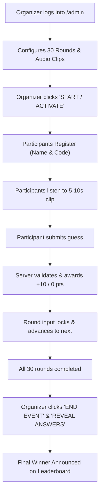

# 🩸 HORROR SONG TRIVIA

> *"Recognize the tune. Survive the night."*

A dark horror-themed, interactive live-event song trivia application built with **React**, **Vite**, **Tailwind CSS**, and **Supabase**. Built for Halloween events, haunted house gatherings, and horror movie trivia nights.

---

## 📽️ Features Overview

- **30 Chilling Rounds**: Exactly 30 audio rounds featuring iconic horror themes, slasher movie scores, and gothic anthems.
- **Strict Anti-Cheating System**:
  - **Single Playback Only**: Each audio clip plays once per participant per round. Seeking, scrubbing, restarting, and replaying are strictly blocked.
  - **Metadata Audio Duration**: Audio duration is probed from file metadata and enforced on both frontend and backend.
  - **10-Second Answer Countdown**: Starts automatically as soon as audio finishes, displayed with a prominent countdown (`TIME LEFT: 10s...`) and decreasing progress bar.
  - **Critical Red Warning**: Intense visual alert during the last 3 seconds of the answer window.
  - **Automatic Expiration**: When the 10-second timer hits 0s, the round input is locked and automatically submitted as expired with 0 points.
  - **Server-Side Timestamps**: Deadlines are calculated on the backend; refreshing the page, switching tabs, or tampering with device clocks cannot grant extra time or replay audio.
  - **No Skip or Re-try**: Participants cannot skip ahead or revisit completed rounds.
- **Atmospheric Horror UI**:

  - Dark charcoal and obsidian void palette (`#060609`, `#0f0f17`)
  - Blood-red accents, crimson glows, and typography (`Cinzel Decorative`, `Creepster`, `Outfit`, `Special Elite`)
  - Ambient haunted house sub-drone audio toggle with Web Audio synthesis
  - Subtle floating mist, grain, and vignette overlays
- **Server-Side Scoring Engine**:
  - Normalized answer comparison (case-insensitive, strips punctuation, handles whitespace and multiple variations)
  - Answers are strictly protected on the backend and never transmitted to participant browsers until revealed by the organizer
  - 10 points per correct answer, 0 for wrong, 300 maximum possible points
  - Unique database constraints prevent multiple submissions for the same round
- **Organizer Control Room (`/admin`)**:
  - Audio manager: upload, preview, and replace audio clips (MP3, WAV, M4A, OGG)
  - Pre-seeded with 30 iconic horror songs & motifs
  - Live game controller: **Lobby Waiting**, **Active**, **Paused**, and **Concluded**
  - Reveal answers toggle (unlocks solutions after event concludes)
  - Live participant tracker, answer submissions inspector, and CSV export
  - Reset game with confirmation dialog
- **Live Survivor Leaderboard (`/leaderboard`)**:
  - Ranked by highest score &rarr; most correct answers &rarr; earliest completion speed
  - Top 3 Supreme Survivors podium (#1 Gold/Crimson, #2 Silver, #3 Bronze)
  - Auto-updates in real time
- **Zero-Setup Mock Fallback**:
  - Connects to Supabase Cloud when configured
  - Seamlessly falls back to a built-in Local Horror Engine in `localStorage` with Web Audio procedural sound synthesis when testing offline

---

## 🛠️ Technology Stack

- **Frontend**: React 19, Vite 8, JavaScript
- **Styling**: Tailwind CSS v4, Lucide Icons, Canvas Confetti
- **Audio Engine**: Web Audio API Procedural Synthesizer + HTML5 Audio Player
- **Backend & Database**: Supabase (PostgreSQL, Row Level Security, RPC Functions)
- **Authentication**: Supabase Auth (Admin email & password)
- **Audio Storage**: Supabase Storage (`song-clips` bucket)
- **Deployment**: Optimized for Vercel, Netlify, or any static host

---

## 🚀 Quick Start (Local Development)

### 1. Clone & Install Dependencies
```bash
git clone <repo-url>
cd SongTrivia
npm install
```

### 2. Configure Environment (Optional for Supabase Cloud)
Copy the example environment file:
```bash
cp .env.example .env
```
Fill in your Supabase credentials in `.env`:
```env
VITE_SUPABASE_URL=https://your-project-id.supabase.co
VITE_SUPABASE_ANON_KEY=your-supabase-anon-key
VITE_ADMIN_DEFAULT_EMAIL=admin@horrortrivia.com
```

> **Note**: If you don't configure Supabase immediately, the application automatically boots in **Local Horror Engine** mode. You can test the full game, register survivors, submit answers, and manage the event in the admin dashboard right away!

### 3. Start the Dev Server
```bash
npm run dev
```
Open [http://localhost:5173](http://localhost:5173) in your browser.

---

## 🗄️ Supabase Cloud Setup

### 1. Run the Database Schema & Functions
1. Open your project in the [Supabase Dashboard](https://supabase.com/dashboard).
2. Navigate to the **SQL Editor** on the left menu.
3. Open `supabase/schema.sql` from this repository.
4. Copy the entire contents, paste it into the SQL Editor, and click **Run**.

This script automatically sets up:
- `game_settings`: Stores event status, active round, and answers revealed state.
- `songs`: Contains the 30 rounds, audio paths, correct titles, and accepted variations.
- `participants`: Stores survivor profiles, scores, and completion timestamps.
- `round_sessions`: Anti-cheating session table tracking playback timestamps, audio duration, state, and 10s answer deadlines per participant per round.
- `submissions`: Records each answer, scored points, and enforces `UNIQUE(participant_id, song_id)`.
- `start_round_playback`: Server RPC authorizing single playback and recording start timestamp.
- `complete_audio_and_start_answering`: Server RPC transitioning round to 10s countdown.
- `submit_song_answer`: `SECURITY DEFINER` function for server-side evaluation with strict deadline validation.
- `get_round_state`: Server RPC restoring state on page refresh or tab re-opening.
- `get_playable_songs`: Secure view that hides answers until the organizer reveals them.
- `get_horror_leaderboard`: Ranked query with multi-tier tie breaking.
- Row Level Security (RLS) policies protecting participant scores from client-side tampering.


### 2. Set Up the Audio Storage Bucket
1. Go to **Storage** in your Supabase Dashboard.
2. Click **New Bucket**.
3. Bucket Name: `song-clips`
4. Make sure **Public bucket** is toggled **ON**.
5. Set file size limit to `10MB`.
6. Allowed MIME types: `audio/mpeg, audio/mp3, audio/wav, audio/x-m4a, audio/mp4, audio/aac, audio/ogg`.
7. Run the storage policies located in `supabase/storage_setup.md` in the SQL Editor.

### 3. Create Organizer Admin Account
In Supabase Dashboard &rarr; **Authentication** &rarr; **Users**:
- Click **Add User** &rarr; **Create User**.
- Email: `admin@horrortrivia.com` (or your preferred organizer email).
- Password: Choose a secure password.

---

## 🎮 Event Flow Walkthrough



---

## 🔐 Security Architecture

- **No Answer Leaks**: Song answers are completely omitted from public API responses (`get_playable_songs`). Even if a participant inspects Network requests or DOM elements, the answers do not exist on the client side until explicitly unlocked by the organizer.
- **Server-Side Scoring**: Evaluation happens inside PostgreSQL via the `submit_song_answer` RPC function or secure server engine.
- **Database Unique Constraints**: `UNIQUE(participant_id, song_id)` prevents replaying or resubmitting rounds.
- **Anti-Tampering RLS**: Participants cannot directly write or edit the `participants.total_score` field; points are only accumulated through authenticated submission functions.

---

## 🚢 Deployment to Vercel

1. Push your repository to GitHub / GitLab.
2. Go to [Vercel](https://vercel.com) and click **Add New** &rarr; **Project**.
3. Import this repository.
4. Framework Preset: **Vite** (detected automatically).
5. Add Environment Variables:
   - `VITE_SUPABASE_URL`
   - `VITE_SUPABASE_ANON_KEY`
6. Click **Deploy**. Your horror event is live on the internet!

---

## 📜 License
MIT License. Created for horror movie enthusiasts, Halloween trivia organizers, and music lovers.
